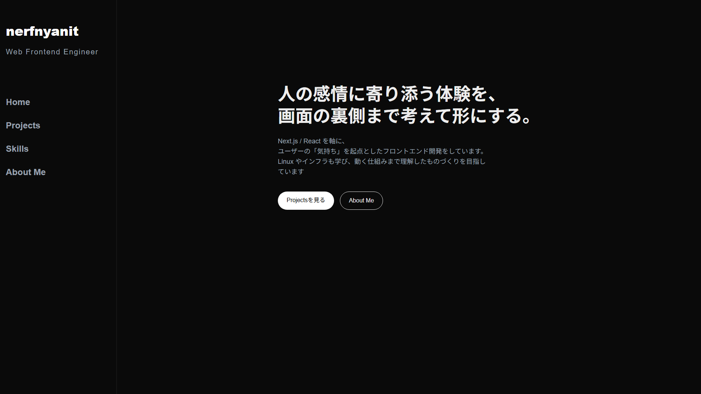

# Portfolio

フロントエンド設計・UI実装を軸に、インフラまで視野に入れて学んでいる  
**Next.js 製ポートフォリオサイト**



---

## 概要
フロントエンドエンジニアを目指し制作した、
Next.js / React を用いた個人ポートフォリオサイトです。

UI/UX・コンポーネント設計・保守性を意識し、
**実務を想定した構成・実装**を行っています。

現在は「作った UI がどこで・どう動いているのか」まで理解するため、
Linux やサーバー構築などのインフラ学習にも取り組んでおり、その内容もサイトに反映しています。

---

## URL
- Portfolio: https://portfolio-nerfnyanits-projects.vercel.app
- GitHub: https://github.com/nerfnyanit/frontend-portfolio

---

## 使用技術
### フロントエンド
- Next.js（App Router）
- React
- TypeScript
- Tailwind CSS

### インフラ・デプロイ
- Vercel
- Linux（AlmaLinux） / SSH / VMware（学習中）

---

## 実装内容
- Home / About / Skills / Projects ページの実装
- カテゴリ別のスキルカード表示（言語 / フレームワーク / クラウド / インフラ / 開発ツール）
- カウンター / Todo などのサンプル機能
- 状態管理を含むインタラクティブな UI

---

## 工夫した点
- **表示とロジックを分離**し、保守性を意識した設計
- スキル情報を `app/data/skills.ts` にデータとしてまとめ、表示（`SkillCard`）と分けて管理
- 再利用性を考慮したコンポーネント構成
- Custom Hook を用いたロジックの共通化
- レスポンシブ対応を考慮した UI 実装

---

## 制作背景・目的
フロントエンド開発において求められる
「設計力」「UI実装力」「継続的な改善姿勢」を
アウトプットとして示すことを目的に制作しました。

単に動くものを作るのではなく、
**実務での可読性・拡張性を意識した実装**を心がけています。

また、フロントエンドだけでなく、アプリが動く環境まで理解したエンジニアを目指して、
学習の進み具合に合わせてサイトの内容も更新しています。

---

## ローカルでの起動
```bash
npm install
npm run dev
```
http://localhost:3000 で確認できます。

---

## 今後の改善予定
- パフォーマンス最適化
- アニメーションの追加
- テストコードの導入
- ブログ機能の追加
- 自分で構築した Linux サーバーへのデプロイ

---

## 作者
- GitHub: https://github.com/nerfnyanit
- X（Twitter）: https://x.com/nerfnyanit
